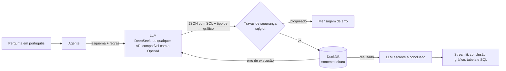

# 🏍️ Fleet AI Analyst

**Pergunte em português sobre a operação de uma frota e receba a resposta com SQL, tabela e gráfico.**

> 🔗 **Demo online: [fleet-ai-analyst-marcos.streamlit.app](https://fleet-ai-analyst-marcos.streamlit.app)** · Todos os dados são fictícios.

<!-- Grave um GIF de 20–40 s usando o app, salve em docs/demo.gif e troque esta linha por:  -->

## O problema

Em operações de frota (locação de motos, recolhimento de veículos, cobrança), quem decide no dia a dia, como supervisores e coordenadores, depende de alguém de dados para responder perguntas simples: *"qual filial está atrasando mais recolhimentos?"*, *"parceiro terceirizado compensa o custo?"*. Cada pergunta vira uma fila de pedidos e uma espera de horas ou dias.

Eu trabalho nesse tipo de operação e conheço essa fila dos dois lados: já fui quem pergunta e quem escreve o SQL.

## A solução

Um agente de IA que traduz a pergunta em uma consulta SQL (*text-to-SQL*), valida, executa e devolve:

- uma **conclusão** de 1 ou 2 frases com os números principais;
- o **gráfico** e a **tabela** do resultado;
- o **SQL gerado**, visível, para qualquer pessoa conferir de onde veio o número.

## Arquitetura



| Arquivo | O que faz |
|---|---|
| `fleet_analyst/dados.py` | Gera a base fictícia (16 filiais, ~2.900 motos, ~7.000 contratos, ~108 mil cobranças, ~660 recolhimentos). Sempre a mesma base, por causa da semente fixa. |
| `fleet_analyst/agente.py` | Monta o prompt, chama o LLM, executa, faz a autocorreção e o resumo. |
| `fleet_analyst/seguranca.py` | Valida o SQL antes de executar. |
| `evals/` | 20 perguntas com a resposta certa e o script que mede o acerto do agente. |
| `app.py` | Interface web. |

## Decisões técnicas

- **Travas de segurança em duas camadas.** O SQL do LLM nunca é executado direto. Primeiro o `sqlglot` lê o SQL como uma árvore e só aceita **um** `SELECT` nas tabelas conhecidas. `DROP`, `DELETE`, `COPY`, `ATTACH`, `read_csv('/etc/passwd')` e afins são bloqueados. Depois, o DuckDB abre em modo **somente leitura e sem acesso a arquivos externos**. Se uma camada falhar, a outra segura. Os testes cobrem 11 tentativas de ataque.
- **Autocorreção limitada a 1 tentativa.** Se o SQL dá erro (por exemplo, uma coluna que não existe), o erro volta para o LLM corrigir uma vez. Se o bloqueio veio das travas, ele não tenta de novo: travas não se negociam.
- **Uma view com as regras de negócio.** "Atrasado" e "dias em aberto" ficam calculados em `vw_recolhimentos`. O LLM não precisa adivinhar a regra, o que reduz erro e mantém a definição igual em todas as respostas.
- **Data de referência fixa.** "Hoje" é 31/10/2026 dentro da base, e o prompt proíbe `current_date`. Assim as respostas não mudam com o passar dos dias, e o eval continua válido.
- **Provedor de LLM trocável.** Qualquer API compatível com a da OpenAI funciona (DeepSeek, Groq, Gemini, OpenAI). Para trocar, basta mudar 3 variáveis de ambiente.
- **Demo pública com limite.** São 15 perguntas por sessão. Sem chave de API, o app entra em **modo demonstração** e responde as perguntas de exemplo, para quem quiser só olhar.

## Avaliação (eval)

Não basta dizer que um agente de IA "funciona": é preciso medir. Em `evals/perguntas.yaml` há **20 perguntas** com o SQL de referência escrito à mão. O script roda cada pergunta no agente e compara o **resultado** com o da referência (não o texto do SQL, porque há vários jeitos certos de escrever a mesma consulta).

```bash
python -m evals.rodar_eval                          # avalia o modelo configurado
python -m evals.rodar_eval deepseek-chat outro-modelo   # compara dois modelos
```

O relatório sai em [`evals/resultados.md`](evals/resultados.md): acertos, tempo médio e quantas perguntas precisaram de autocorreção. Para cada erro, `evals/erros_<modelo>.md` mostra o SQL gerado ao lado do de referência.

| Modelo | Acertos | Tempo médio por pergunta |
|---|---|---|
| DeepSeek V3 (`deepseek-chat`) | **20/20** | 1,5 s |

### O que o eval me ensinou

A primeira rodada deu **11/20 (55%)**. Antes de mexer no prompt, li o SQL de cada erro e encontrei três causas, **nenhuma delas um SQL errado do modelo**:

1. **O avaliador era rígido demais.** O modelo escreveu o mês como `2026-05` e a referência como `2026-05-01`. Era a mesma resposta, então o comparador passou a aceitar os dois formatos.
2. **As regras de negócio eram ambíguas.** Recolhimento cancelado tem custo? Cobrança que vence hoje já está "vencida"? Cada leitura razoável dava um número diferente. As definições foram documentadas no esquema que o LLM lê, que é o mesmo que um analista novo precisaria saber.
3. **Uma pergunta estava mal escrita.** "Percentual de cobranças pagas com atraso" não dizia sobre qual total. A pergunta foi reescrita.

Depois disso: **16/20**, e então **20/20**. Os 4 erros intermediários vieram de uma base local desatualizada, que agora tem versão e é recriada sozinha quando a regra de geração muda. Também apareceu uma oscilação: a mesma pergunta sobre inadimplência acertou numa rodada e errou na outra, o que mostra que o modelo nem sempre responde igual. Por isso, o próximo passo é rodar o eval várias vezes e reportar a faixa de acerto, não um número só.

## Como rodar

```bash
git clone https://github.com/MarcosVVSantos/fleet-ai-analyst.git
cd fleet-ai-analyst
python -m venv .venv && source .venv/bin/activate   # no Windows: .venv\Scripts\activate
pip install -r requirements.txt
cp .env.example .env        # e coloque sua chave de API
streamlit run app.py        # a base fictícia é gerada na primeira execução
pytest                      # 22 testes: segurança, fluxo do agente, base e comparador do eval
```

Sem chave no `.env`, o app abre em modo demonstração.

## Próximos passos

- Memória de conversa ("e em setembro?" depois de uma pergunta sobre outubro).
- Rodar o eval 5 vezes por modelo e reportar a faixa de acerto; comparar com um segundo modelo.
- Mais perguntas difíceis no eval (comparações entre períodos, perguntas ambíguas).
- Registrar o custo de cada pergunta (tokens) no relatório do eval.

---

Feito por **Marcos Vinicio Vieira dos Santos** · [LinkedIn](https://www.linkedin.com/in/marcos-v-v-santos) · [GitHub](https://github.com/MarcosVVSantos)
